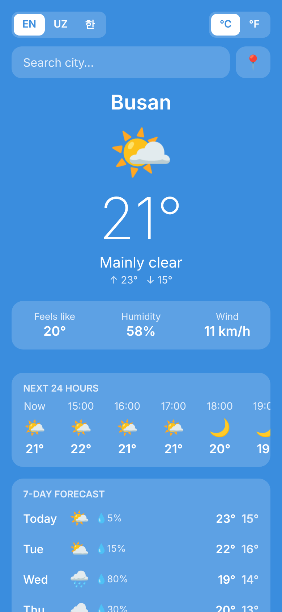
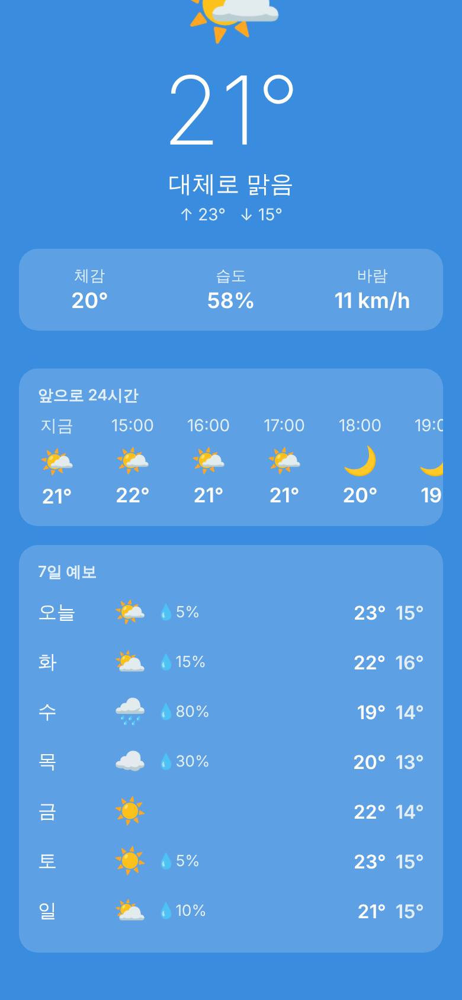
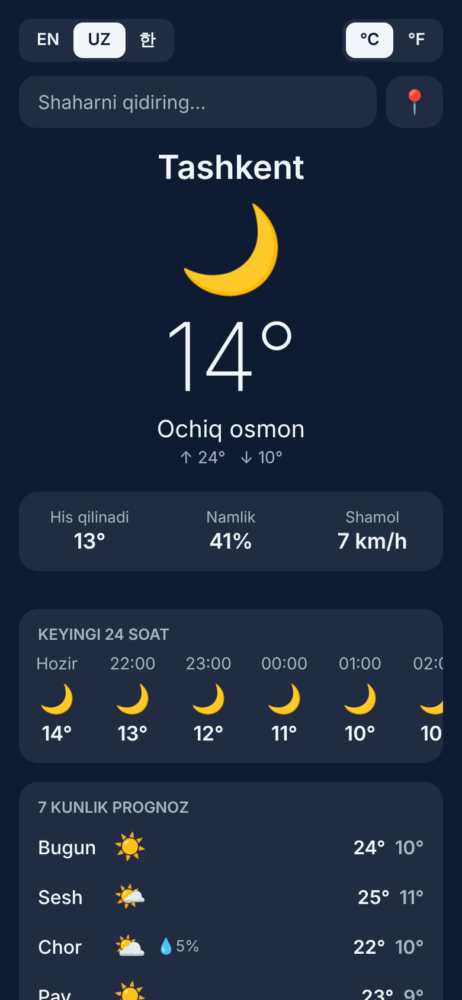

# Weather

Download

<a href="https://github.com/As0d1/WeatherApp/releases/download/v1.0.0/weather-v1.0.0.apk">  </a>

Android users can click the button above to download Weather v1.0.0 directly.

Alternatively, visit the Releases page to find the latest version.

A cross-platform weather app for iOS and Android, built with **React Native**, **Expo** and **TypeScript**.

It shows the current weather, the next 24 hours and a 7-day forecast for your location or any city in the world, in **English, Uzbek and Korean**.

<p align="center">
  
  
  
</p>

## Features

- 📍 Weather for your current location (falls back to Busan if location access is off)
- 🔎 City search with debounced requests
- 🌡️ Current temperature, feels-like, humidity and wind
- 🕒 Hourly forecast for the next 24 hours
- 📅 7-day forecast with chance of rain
- 🌐 English / O'zbekcha / 한국어, picked from the device language by default
- °C / °F switch (wind switches between km/h and mph)
- 🎨 Background changes with day, night and cloudy weather
- 💾 Remembers the last city, language and unit
- 🔄 Pull to refresh

## Tech stack

| Area | Choice |
| --- | --- |
| Framework | React Native 0.86 + Expo SDK 57 |
| Language | TypeScript (strict) |
| Data | [Open-Meteo](https://open-meteo.com/) forecast and geocoding APIs (free, no API key) |
| Device APIs | `expo-location`, `expo-localization` |
| Storage | `@react-native-async-storage/async-storage` |
| Testing | Jest (`jest-expo`) + React Native Testing Library |
| CI | GitHub Actions: typecheck, lint, tests |

## Download

Android users can install the latest APK from the [Releases page](https://github.com/husanboyqodirov/NewMobileProject/releases/latest).

## Getting started

You need [Node.js](https://nodejs.org/) 20 or newer and the **Expo Go** app on your phone ([iOS](https://apps.apple.com/app/expo-go/id982107779) / [Android](https://play.google.com/store/apps/details?id=host.exp.exponent)).

```bash
npm install
npm start
```

Scan the QR code in the terminal with Expo Go (Android) or the Camera app (iOS).

## Scripts

| Command | What it does |
| --- | --- |
| `npm start` | Start the Expo dev server |
| `npm run android` / `npm run ios` | Open on an emulator or simulator |
| `npm run web` | Open in the browser |
| `npm test` | Run the unit and component tests |
| `npm run typecheck` | Type-check with TypeScript |
| `npm run lint` | Lint with ESLint |

## Project structure

```
App.tsx                    Providers and root screen
src/
  api/weather.ts           Open-Meteo client and response parsing
  components/              UI: search, current weather, hourly, daily, settings
  hooks/                   useWeather (fetching), usePersistentState (AsyncStorage)
  i18n/                    Translations (en, uz, ko) and language context
  screens/WeatherScreen.tsx
  utils/                   Formatting, weather codes and themes, device location
```

Tests live next to the code in `__tests__` folders.

## Releasing

Push a version tag (for example `git tag v1.0.1 && git push origin v1.0.1`), or open **Actions → Release → Run workflow** and enter the version. The [Release workflow](.github/workflows/release.yml) builds the Android APK and publishes it as a GitHub release. Bump `version` (and `android.versionCode`) in `app.json` first.

## Credits

Weather data by [Open-Meteo.com](https://open-meteo.com/) (CC BY 4.0).

## License

[MIT](LICENSE) © Asadbek Rustamov
